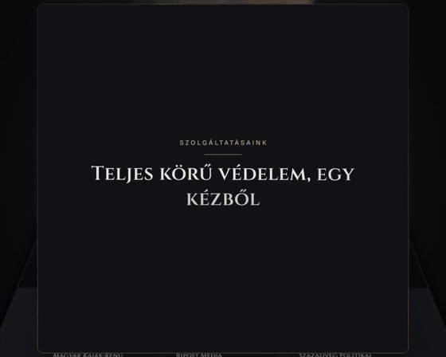
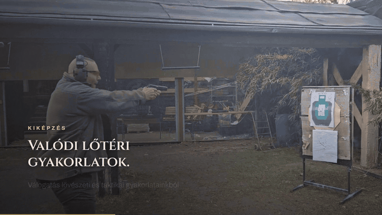
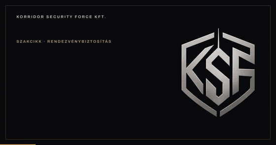

# Motion Design Portfolio

Short motion design videos I made for web interfaces: a Power BI report opener and promo videos for a company website. All videos are silent by design, so they work as autoplay loops on a page. Click a preview to play the full video.

## iGaming Power BI report

Opening animation for an iGaming analytics report (Power BI): report title, page navigation and a gold and black theme. The opening background image (dice, chips and phone) is **AI-generated**; the title and navigation animation are motion design. 30 s, 1920x1080.

## KSF Kft. website (ksfkft.hu)

Videos made for the website and social channels of a Hungarian security company. Each video is labeled: **AI-generated** means the footage was created with generative AI tools, **Real footage** means it was recorded, not generated.

### Homepage flythrough
**AI-generated.** A scroll-through of the homepage as an animated tour. 42 s, 1440x1152.

### Company intro
**AI-generated.** Main intro film for the site, with a vertical cut for Reels, TikTok and Shorts. 35 s (16:9) and 20 s (9:16).

| 16:9 | 9:16 |
|---|---|
|  |  |

### Training intro
**Real footage** (not AI-generated). Short intro for the firearms training page. 20 s, 1920x1080.

### LinkedIn animations
**AI-generated.**

| Brand card (1200x628, 8 s) | Carousel (1080x1350, 26 s) |
|---|---|
|  |  |

## Notes

- Videos are H.264 MP4 without an audio track.
- The iGaming opener uses an AI-generated background image.
- The KSF videos are AI-generated except the training intro, which uses real footage.
- The previews are 5 to 6 second excerpts; the links open the full video.

Made by Zoltan Kothencz.
